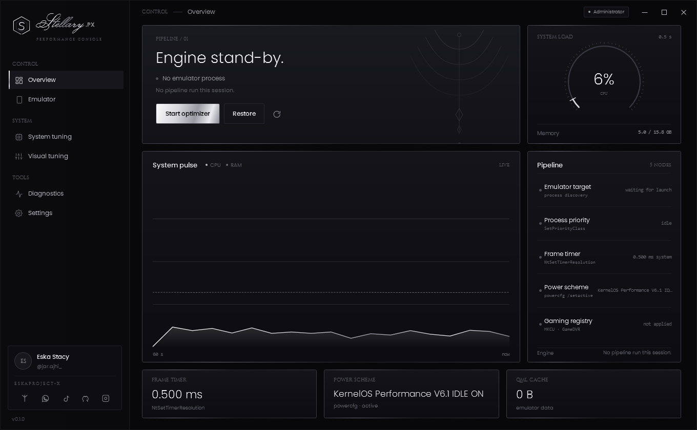
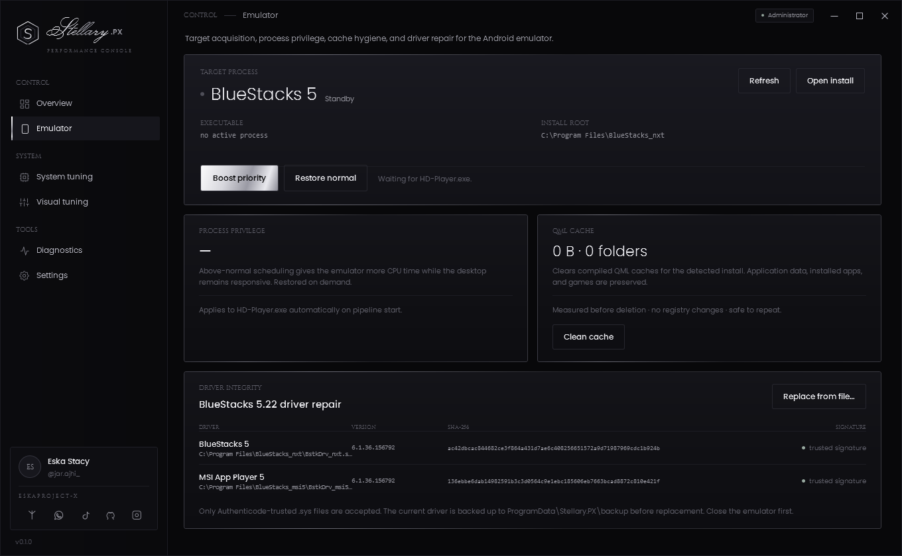
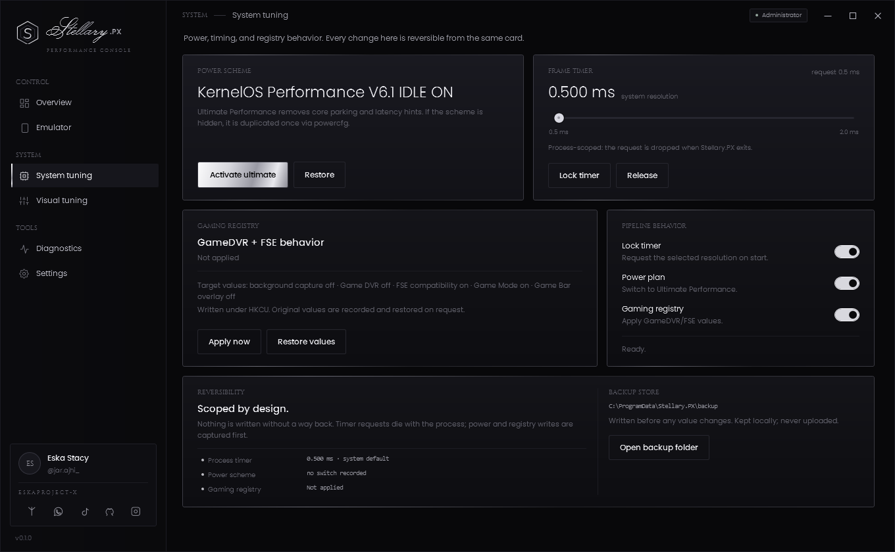
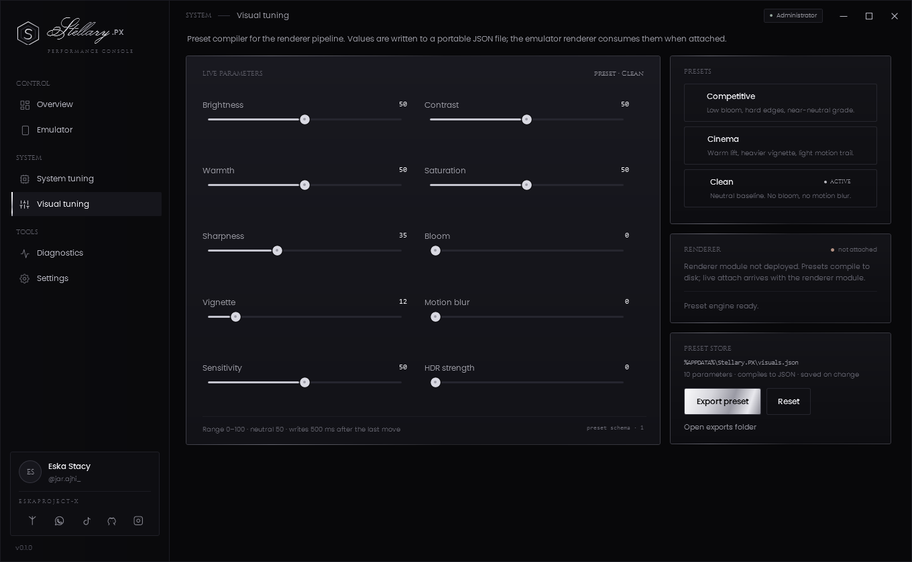
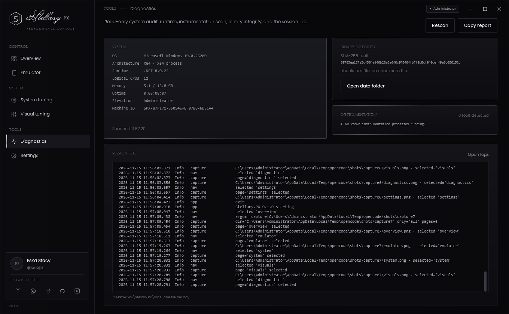
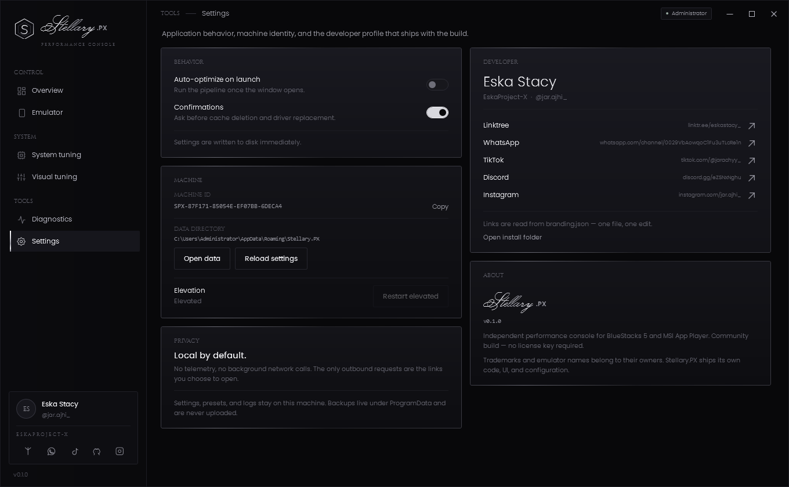

# Stellary.PX

**A local-first Windows performance console for Android emulators.**  
Black chrome, measured claims, reversible changes.



Stellary.PX is an independent, clean-room rebuild of the behavior documented in
`reference tool`: emulator discovery, process priority, Windows timer
resolution, Ultimate Performance power schemes, GameDVR/FSE registry behavior,
QML cache hygiene, BlueStacks driver inspection, visual preset compilation, and
diagnostics. The interface is original. No code, assets, license logic, or
anti-analysis routines from the source binary are reused.

---

## What it does

### Overview
A live system pulse sampled at 2 Hz (60-second window), a CPU ring gauge, and a
five-node pipeline ledger. One action applies the enabled stages; one action
restores what can be restored. Every row names the mechanism it uses
(`SetPriorityClass`, `NtSetTimerResolution`, `powercfg`, `HKCU`).

### Emulator
- Detects `HD-Player.exe` and classifies BlueStacks 5 vs. MSI App Player 5.
- Boosts the running emulator to `AboveNormal` and restores the prior class.
- Measures and clears compiled QML caches only; application data and games are
  preserved.
- Inventories BlueStacks kernel drivers with file version, full SHA-256, and
  Authenticode trust state.
- Repairs a driver **from a user-supplied, Authenticode-trusted `.sys` file**,
  backs up the existing driver, and verifies the copied hash. It never downloads
  a driver.

### System tuning
- Queries the active power scheme, activates Ultimate Performance (duplicating
  the hidden scheme once when needed), and restores the captured GUID.
- Holds an `NtSetTimerResolution` request between 0.5 ms and 2.0 ms for the life
  of the process, then releases it on request or exit.
- Applies seven `HKCU` GameDVR / FSE / Game Bar values after recording their
  originals, and restores them later.
- A reversibility ledger shows what is currently held, what is backed up, and
  where backups live.

### Visual tuning
- Ten renderer parameters compiled into a portable JSON preset.
- Three baselines: Competitive, Cinema, Clean.
- Export and reset actions; presets persist under `%APPDATA%\Stellary.PX`.
- The renderer attachment state is reported honestly. This build compiles
  presets; the optional native renderer module is a separate deliverable.

### Diagnostics
- Runtime, CPU, memory, uptime, elevation, and machine fingerprint.
- SHA-256 of the running binary and verification against `SHA256SUMS.txt`.
- Read-only scan for known instrumentation processes. It warns; it does not
  block, kill, or retaliate.
- Session log viewer, report copy, and data-folder shortcuts.

### Settings
- Start behavior, confirmations, timer/power/registry opt-ins.
- Data directory, elevation restart, privacy statement.
- Developer profile and links, version and build identity.

---

## Screens

| | |
|---|---|
|  |  |
| **Emulator** — target, priority, QML cache, driver integrity | **System tuning** — power, timer, registry, reversibility |
|  |  |
| **Visual tuning** — preset compiler and store | **Diagnostics** — audit, integrity, instrumentation, log |
|  | |
| **Settings** — behavior, privacy, developer profile | |

---

## Safety model

Stellary.PX is deliberately boring about trust:

- **No remote driver downloads.** Driver repair accepts a local, signed `.sys`
  file and validates its Authenticode chain before replacing anything.
- **No license server, HWID check-in, or key enforcement.** This community build
  has no activation gate and makes no license requests.
- **No anti-analysis behavior.** The instrumentation scan reports processes; it
  never terminates them, hides the app, or blocks debugging.
- **No obfuscation or packing.** The managed assembly is inspectable.
- **No telemetry.** The only outbound requests are links you explicitly open.
- **No silent persistence.** Registry and power changes are user-initiated,
  captured first, and restorable from the same screen. Timer requests are
  process-scoped and released on exit.
- **No fake signatures.** Release builds are signed only with a real CA-issued
  certificate. If no certificate is configured, the build is published as
  explicitly unsigned.

Details: [SECURITY.md](SECURITY.md).

---

## Requirements

- Windows 10 1903+ or Windows 11, x64.
- [.NET 8 Desktop Runtime](https://dotnet.microsoft.com/download/dotnet/8.0)
  (framework-dependent build).
- Administrator elevation for power-scheme changes and driver repair.
- BlueStacks 5 or MSI App Player 5 for emulator-specific features. The rest of
  the console works without it.

---

## Install and verify

1. Download the release ZIP and `SHA256SUMS.txt`.
2. Verify the archive or executable:

   ```powershell
   Get-FileHash .\Stellary.PX.exe -Algorithm SHA256
   Get-Content .\SHA256SUMS.txt
   ```

   The hashes must match. A helper is included:

   ```powershell
   .\scripts\Verify-Release.ps1 -Path .\Stellary.PX.exe -Sums .\SHA256SUMS.txt
   ```

3. If the release is signed, inspect the signer:

   ```powershell
   Get-AuthenticodeSignature .\Stellary.PX.exe | Format-List Status,SignerCertificate
   ```

   `Status` must be `Valid` and the subject must match the published signer.
   Unsigned community builds report `NotSigned`; they are never described as
   signed.

4. Extract to a folder you control and run `Stellary.PX.exe`.

Settings, presets, and logs live in `%APPDATA%\Stellary.PX`. Driver and registry
backups live in `%ProgramData%\Stellary.PX`.

---

## Build from source

```powershell
# From the repository root
dotnet build Stellary.PX.sln -c Release

# Framework-dependent publish
dotnet publish src\Stellary.PX\Stellary.PX.csproj -c Release -r win-x64 `
  --self-contained false -o dist\Stellary.PX
```

The release helper performs a clean publish, writes `SHA256SUMS.txt`, and
produces a versioned ZIP:

```powershell
.\scripts\Build-Release.ps1 -Version 0.1.0
```

Signing requires `signtool.exe` and a CA-issued certificate:

```powershell
.\scripts\Sign-Release.ps1 -Path .\dist\Stellary.PX\Stellary.PX.exe `
  -Pfx .\secrets\codesign.pfx -Password (Read-Host -AsSecureString)
```

See [docs/06-RELEASE.md](docs/06-RELEASE.md) for the full pipeline, including
timestamping and verification.

---

## Tests

The service harness has no external dependencies:

```powershell
dotnet run --project tests\Stellary.PX.Tests -c Release
```

The default pass is read-only (16 checks). Add `--system` to exercise the
reversible timer, power-plan, and registry round-trips (19 checks). The harness
captures and restores real state, then prints `passed / failed / skipped`.

UI verification uses the deterministic capture mode:

```powershell
.\Stellary.PX.exe --capture .\artifacts\shots
.\Stellary.PX.exe --capture .\artifacts\shots --page system
```

Captures render the real WPF visual tree, verify the selected page before each
save, and log `selected='<key>'`. See [docs/05-TEST-PLAN.md](docs/05-TEST-PLAN.md).

---

## Architecture

- **.NET 8 / WPF**, framework-dependent, zero NuGet dependencies.
- Custom window chrome, embedded OFL fonts, vector-only iconography.
- Services are UI-agnostic and testable; the WPF layer binds to view models.
- Long operations run on the thread pool; the dispatcher only receives results.
- Settings and presets use an atomic JSON store; logs are append-only.
- Native interop is limited to `NtSetTimerResolution` /
  `NtQueryTimerResolution`, memory/CPU sampling, DWM attributes, and
  `WinVerifyTrust`.

Read [docs/03-ARCHITECTURE.md](docs/03-ARCHITECTURE.md) for the layer map and
[docs/02-FEATURE-MAP.md](docs/02-FEATURE-MAP.md) for the source-to-rebuild
feature matrix.

---

## Documentation

| Document | Contents |
|---|---|
| [01 · Reverse engineering](docs/01-REVERSE-ENGINEERING.md) | Binary profile, observed behavior, safety boundaries |
| [02 · Feature map](docs/02-FEATURE-MAP.md) | Source capability → Stellary.PX implementation |
| [03 · Architecture](docs/03-ARCHITECTURE.md) | Layers, services, data flow, threading |
| [04 · Design system](docs/04-DESIGN-SYSTEM.md) | Palette, type, spacing, chrome, motion |
| [05 · Test plan](docs/05-TEST-PLAN.md) | Harness, capture mode, manual matrix |
| [06 · Release](docs/06-RELEASE.md) | Build, publish, checksums, signing |
| [Changelog](CHANGELOG.md) | Release history |
| [Contributing](CONTRIBUTING.md) | Development workflow |
| [Security](SECURITY.md) | Trust model and reporting |

---

## Developer

**Eska Stacy** · EskaProject-X · `@jar.ajhi_`

- [Linktree](https://linktr.ee/eskastacy_)
- [WhatsApp channel](https://whatsapp.com/channel/0029VbAowqoC1Fu3uTLcRe1n)
- [TikTok](https://www.tiktok.com/@jarachyy_?_r=1&_t=ZS-99b76hsvJha)
- [Discord](https://discord.gg/eZSNxNghu)
- [Instagram](https://www.instagram.com/jar.ajhi_)

All links are configured in one place: `src/Stellary.PX/branding.json`.

---

## License

MIT. See [LICENSE](LICENSE).

Stellary.PX is an independent project. It is not affiliated with BlueStacks,
MSI, Microsoft, or the authors of reference tool. BlueStacks and MSI App Player
are trademarks of their respective owners.
